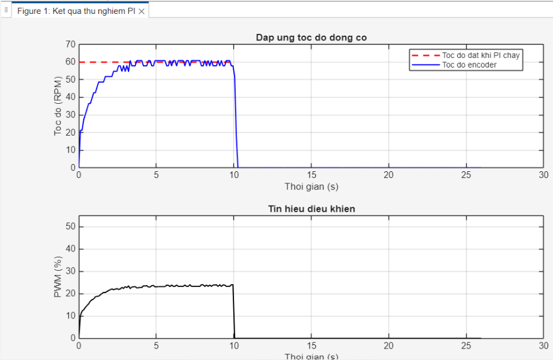
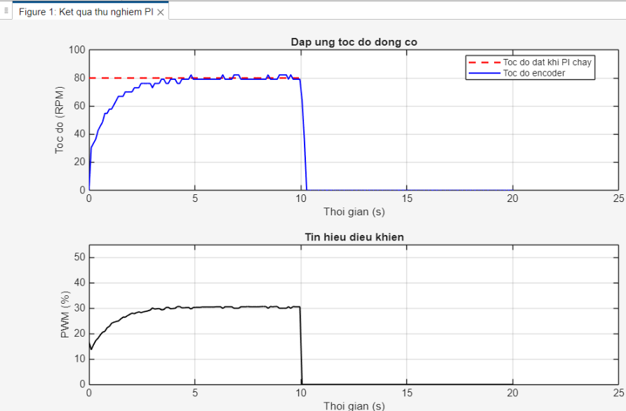
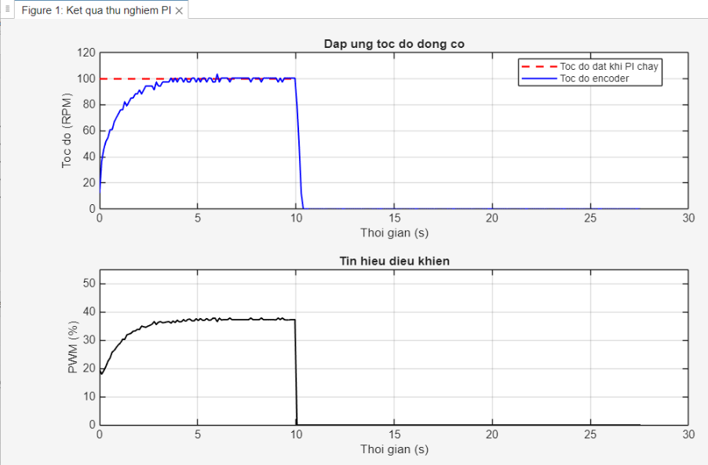

# Thử nghiệm điều khiển PI — 03/11/2026

Script thu thập dữ liệu: [motor_pi_log.m](../../../motor_pi_log.m)

- Kp = 0.20; Ki = 0.50.
- Mỗi lượt chạy trong 10 giây.
- Giới hạn PWM: 50%.
- Thử ở ba mức tốc độ đặt: 60, 80 và 100 RPM.

| Tốc độ đặt | File dữ liệu | Ảnh đồ thị |
|---|---|---|
| 60 RPM | motor_pi_20261103_164114.csv | pi_60rpm.png |
| 80 RPM | motor_pi_20261103_163532.csv | pi_80rpm.png |
| 100 RPM | motor_pi_20261103_162856.csv | pi_100rpm.png |

Các ảnh là đồ thị của file CSV tương ứng, được vẽ bằng script trên.

## Kết quả 60 RPM

## Kết quả 80 RPM

## Kết quả 100 RPM

