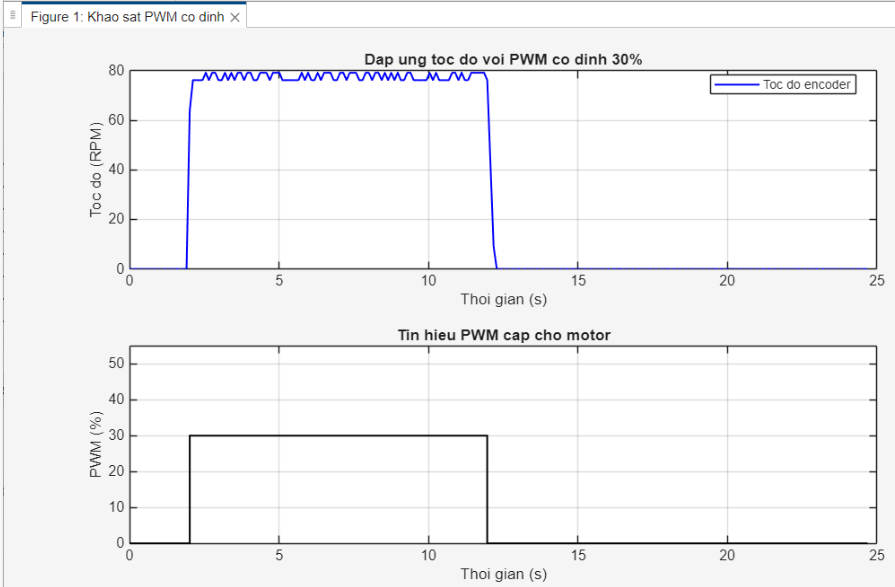

# Thử nghiệm PWM cố định 30% — 03/11/2026

Script thu thập dữ liệu: [motor_pwm_log.m](../../../motor_pwm_log.m)

- Chờ khoảng 2 giây.
- Chạy PWM cố định 30% trong 10 giây rồi dừng.
- File dữ liệu: motor_pwm30_20261103_205414.csv.
- Ảnh đồ thị: pwm30.png.
- Khoảng thời gian giữa các mẫu UART: 106–107 ms.
- Tốc độ trung bình trong 5 giây cuối khi cấp PWM: 77.73 RPM.

Dữ liệu này chưa đủ chi tiết để xác định chính xác thời gian tăng tốc.

## Đồ thị

